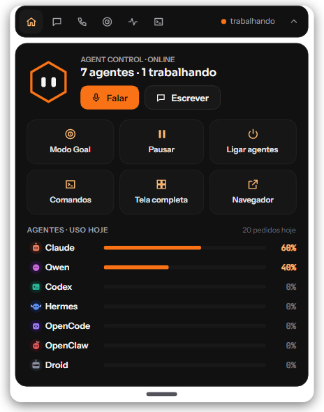
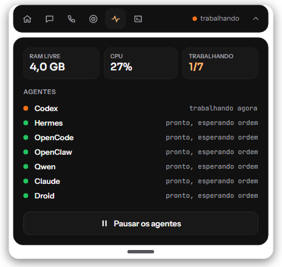

  

<h1 align="center">Agent Control</h1>

<strong>Seus agentes de IA. Um só centro de comando.</strong>

  Acompanhe tarefas, veja o código evoluir e coordene Claude Code, Codex, Gemini CLI, Qwen Code e outros agentes — com aprovações, histórico e controle de verdade.

  <a href="https://davi617.github.io/AgentControl/#baixar"><strong>Baixar a versão estável</strong></a>
  · <a href="https://davi617.github.io/AgentControl/">Explorar o site</a>
  · <a href="https://davi617.github.io/AgentControl/instalar/">Guia de instalação</a>
  · <a href="#pr%C3%B3xima-atualiza%C3%A7%C3%A3o-450">O que vem na 4.5.0</a>

  
  
  
  

---

## Pare de trocar de janela para acompanhar cada agente

O Agent Control organiza seu time de ferramentas de IA em uma experiência com **Central de Missões, sala de conversa, HUD e aplicativo para celular**. Você continua decidindo o que pode ser executado.

  

### O que você consegue fazer hoje

| Recurso | Na prática |
|---|---|
| **Central de Missões** | Acompanhar objetivos, tarefas, responsáveis e resultados em um só lugar. |
| **Código ao vivo** | Ver arquivos alterados, diffs e atividade das worktrees dos agentes. |
| **AgentC + HUD** | Consultar o estado do time sem perder o contexto do que você está fazendo. |
| **Comandos e aprovações** | Enviar ordens e exigir aprovação antes de ações protegidas. |
| **Sala e chamada** | Acompanhar conversas e coordenar a colaboração do time. |
| **Fila anti-429** | Organizar as requisições para lidar com limites compartilhados do provedor. |
| **Segurança e auditoria** | Controle de acesso por papel, botão de pânico e trilha de auditoria na linha 4.x. |
| **PC + celular** | Usar o app desktop e acompanhar pelo Android; acesso no iPhone/iPad via navegador, conforme o guia. |

  

## Próxima atualização: 4.5.0

A **4.5.0 está em preparação técnica**. Os recursos abaixo têm uma base de desenvolvimento registrada, mas **ainda não fazem parte do download estável**:

- **Fallback inteligente:** tentar um modelo de reserva configurado quando a resposta inicial demora ou há erros previstos, respeitando limites de segurança e a fila anti-429.
- **Mission Control ampliado:** missões com dependências, responsáveis, critérios, checkpoints e acompanhamento de execução.
- **Supervisor:** indicar possíveis travamentos por ausência de atividade, para revisão humana; não reinicia processos automaticamente.
- **Evidence Center:** registrar evidências e resultados com hash de integridade.
- **Pesquisa rápida:** navegação por Ctrl+K/Cmd+K e acesso por toque na interface web.

**Estado do lançamento:** essa atualização ainda precisa passar por testes completos, compilação de desktop/Android, conferência da assinatura do APK e validação da publicação antes de ser anunciada como estável. Algumas ideias planejadas (como editor visual de fluxos, marketplace de skills e controle de workers em múltiplos dispositivos) **não são recursos prontos da 4.5.0**.

Acompanhe a [versão estável e seus arquivos oficiais](https://github.com/davi617/AgentControl/releases/latest). A 4.5.0 só aparecerá ali depois da validação e publicação.

## Instalar

| Plataforma | Download / instruções |
|---|---|
| **Windows 10/11 (x64)** | [Baixar](https://davi617.github.io/AgentControl/#baixar) · [Instalar](https://davi617.github.io/AgentControl/instalar/windows.html) |
| **Linux (x64 e ARM64)** | [Baixar](https://davi617.github.io/AgentControl/#baixar) · [Instalar](https://davi617.github.io/AgentControl/instalar/linux.html) |
| **macOS (Apple Silicon e Intel)** | [Baixar](https://davi617.github.io/AgentControl/#baixar) · [Instalar](https://davi617.github.io/AgentControl/instalar/mac.html) |
| **Android** | [Baixar APK](https://davi617.github.io/AgentControl/#baixar) · [Instalar](https://davi617.github.io/AgentControl/instalar/android.html) |
| **iPhone / iPad** | [Adicionar pelo Safari](https://davi617.github.io/AgentControl/instalar/iphone.html) |

> **Antes de instalar:** baixe apenas da página oficial e confira o SHA-256 disponibilizado junto à release. Para atualizar o Android, preserve os dados e use um APK assinado de forma compatível com a instalação anterior.

## Privacidade, segurança e limites

O servidor local opera em **127.0.0.1 por padrão**. O acesso remoto exige configuração e autenticação próprias; não é necessário expor portas do roteador para começar. O produto inclui mecanismos de aprovação, filtragem de segredos e auditoria, mas isso **não dispensa revisar os comandos, as permissões e a configuração dos provedores de IA**.

**Nenhuma chave de API deve aparecer neste repositório, no README ou em capturas de tela.** Credenciais pertencem às configurações locais e aos gerenciadores de segredos apropriados, nunca ao código versionado.

## Código-fonte e licenciamento

Este repositório público reúne o site, a documentação e os downloads de distribuição. O **código-fonte atual é mantido em repositório privado** e a versão atual é proprietária. As versões disponibilizadas até a **4.3.0** sob a licença MIT conservam os direitos concedidos por aquela licença.

## Links úteis

[Site oficial](https://davi617.github.io/AgentControl/) · [Releases](https://github.com/davi617/AgentControl/releases) · [Instalação](https://davi617.github.io/AgentControl/instalar/) · [Reportar problema ou sugerir melhoria](https://github.com/davi617/AgentControl/issues)

Agent Control · Um centro de comando para trabalhar com agentes de IA, com supervisão humana.

